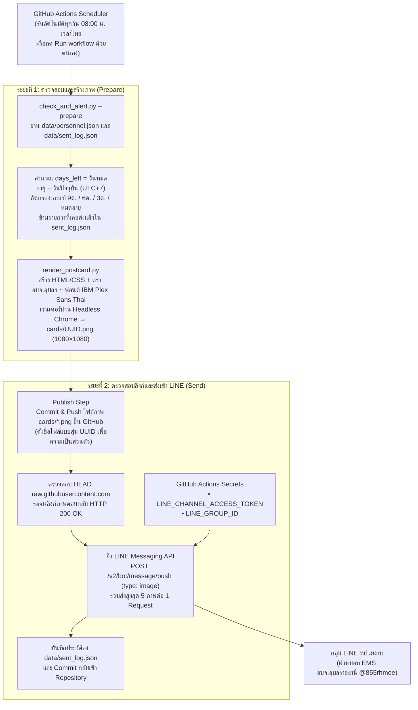

# รายงานการพัฒนาและติดตั้งระบบแจ้งเตือนวันหมดอายุใบประกอบวิชาชีพและบัตรประจำตัวผู้ปฏิบัติการอัตโนมัติ ผ่าน LINE Official Account

**หน่วยงาน:** หน่วยปฏิบัติการแพทย์กู้ชีพระดับสูง (EMS) องค์การบริหารส่วนจังหวัดอุบลราชธานี  
**วันที่จัดทำรายงาน:** 19 พฤศจิกายน 2569  
**ช่องทางแจ้งเตือน:** LINE Official Account ชื่อ **EMS อบจ.อุบลราชธานี** (`@855rhmoe`)  
**ระบบประมวลผลอัตโนมัติ:** GitHub Actions (`chanintales555-ctrl/ubon-pao-ems-license-alert`)  
**เอกสารอ้างอิงฐานข้อมูล:** *ทะเบียนผู้ปฏิบัติการของกู้ชีพระดับสูง องค์การบริหารส่วนจังหวัดอุบลราชธานี และสำเนาใบประกาศนียบัตรผู้ปฏิบัติการแพทย์ฉุกเฉิน* (`4.1.2(1.1) มีการบริหารจัดการให้ผู้ปฏิบัติมีคุณว.pdf`)

---

## 1. ความเป็นมาและวัตถุประสงค์ (จัดทำมาเพื่ออะไร)

### 1.1 สภาพปัญหาและความจำเป็น
การปฏิบัติงานของหน่วยปฏิบัติการแพทย์กู้ชีพระดับสูง (Advanced Life Support / EMS) มีข้อกำหนดด้านมาตรฐานวิชาชีพที่เข้มงวด บุคลากรผู้ปฏิบัติงานแต่ละตำแหน่งจำเป็นต้องมี **ใบประกอบวิชาชีพ** (สำหรับพยาบาลเวชปฏิบัติฉุกเฉิน `ENP`, นักปฏิบัติการฉุกเฉินการแพทย์ `PMD`, พยาบาลวิชาชีพ `พว.`) หรือ **บัตรประจำตัวผู้ปฏิบัติการแพทย์ฉุกเฉิน** (สำหรับ `พฉพพ`, `EMT`, `EMR`) ที่ยังมีผลบังคับใช้ตลอดเวลา

อย่างไรก็ตาม การตรวจสอบวันหมดอายุแบบเดิมที่อ้างอิงจากแฟ้มเอกสารกระดาษหรือไฟล์ PDF มีข้อจำกัดสำคัญ ได้แก่:
1. **ความเสี่ยงจากการหลงลืมวันครบกำหนด:** บุคลากรแต่ละรายมีวันหมดอายุแตกต่างกัน (พ.ศ. 2569–2574) ทำให้ผู้รับผิดชอบต้องเปิดตรวจสอบตารางด้วยตนเองเป็นระยะ หากคลาดสายตาอาจเกิดกรณีใบประกอบวิชาชีพหมดอายุก่อนดำเนินการต่ออายุ (ซึ่งพบแล้ว 1 กรณีในทะเบียนปัจจุบัน)
2. **ระยะเวลาเตรียมเอกสารและหน่วยคะแนนการศึกษาต่อเนื่อง (CNEU/CEU):** การต่ออายุใบประกอบวิชาชีพต้องใช้เวลาล่วงหน้าในการเก็บหน่วยคะแนนและยื่นเอกสาร หากแจ้งเตือนกระชั้นชิดเกินไปจะดำเนินการไม่ทัน
3. **การสื่อสารในหน่วยงาน:** บุคลากรปฏิบัติงานเป็นผลัด/เวร การสื่อสารผ่าน **กลุ่ม LINE** ที่ใช้งานจริงทุกวันจึงเป็นช่องทางที่เข้าถึงและมองเห็นได้รวดเร็วที่สุด

### 1.2 วัตถุประสงค์ของระบบ
1. **แจ้งเตือนเชิงรุกล่วงหน้าแบบแบ่งระดับ (3 ระยะ):** แจ้งเตือนล่วงหน้า **9 เดือน (สีเขียว)**, **6 เดือน (สีเหลือง)** และ **3 เดือน (สีแดง)** รวมถึงกรณี **เลยกำหนดหมดอายุแล้ว (สีแดงเข้ม)** เพื่อให้บุคลากรและหัวหน้าชุดมีเวลาวางแผนต่ออายุได้ทันท่วงที
2. **สื่อสารด้วยภาพโปสต์การ์ดที่อ่านจบในพริบตา:** สร้างไฟล์ภาพโปสต์การ์ดขนาด `1080 × 1080 px` แยกรายบุคคล พร้อมตรา **องค์การบริหารส่วนจังหวัดอุบลราชธานี** และรหัสสีตามระดับความเร่งด่วน ทำให้สมาชิกในกลุ่ม LINE มองเห็นชัดเจนบนหน้าจอมือถือทันที
3. **ทำงานอัตโนมัติ 100% และไม่รบกวนแชทกลุ่ม:** ตรวจเช็กทุกเช้าเวลา **08:00 น.** โดยอัตโนมัติ บอทปิดข้อความทักทายและข้อความตอบกลับอัตโนมัติทั้งหมด และมีระบบบันทึกประวัติเพื่อไม่ให้ส่งซ้ำในรอบเดิม
4. **ประหยัดงบประมาณสูงสุด (ค่าใช้จ่าย 0 บาท/เดือน):** ออกแบบสถาปัตยกรรมแบบ Serverless บนบริการฟรีของ **GitHub Actions** ร่วมกับ **LINE OA แพ็กเกจฟรี** โดยไม่ต้องเช่าเซิร์ฟเวอร์หรือเสียค่าดูแลรายเดือน
5. **ดูแลรักษาและอัปเดตข้อมูลได้ง่ายในระยะยาว:** เก็บรายชื่อเป็นไฟล์โครงสร้างมาตรฐาน (`data/personnel.json`) พร้อมสิทธิ์ Deploy Key เฉพาะโปรเจกต์เพื่อรองรับการแก้ไขในอนาคต

---

## 2. ขอบเขตข้อมูลบุคลากรในระบบ (16 รายชื่อ)

ระบบนำเข้าข้อมูลครบทั้ง **16 รายชื่อ** จากเอกสารทะเบียนบุคลากรฯ โดยครอบคลุมทั้งวันหมดอายุ **ใบประกอบวิชาชีพ** และ **บัตรประจำตัวผู้ปฏิบัติการ** ดังนี้ (คำนวณสถานะ ณ วันที่ 19 พฤศจิกายน 2569):

| ลำดับ | ชื่อ – สกุล | คุณวุฒิ | ตำแหน่งในหน่วย | ใบประกอบวิชาชีพหมดอายุ | บัตรผู้ปฏิบัติการหมดอายุ | สถานะ ณ 19 พ.ย. 2569 |
| :---: | :--- | :---: | :--- | :---: | :---: | :--- |
| 1 | น.ส.สราลี บุตรวงศ์ | ENP | หัวหน้าชุด | 6 ส.ค. 2573 (`๖ ส.ค. ๗๓`) | — | ปกติ (รอถึงรอบ 9 เดือน) |
| 2 | นางนิตยา พันธ์สุวรรณ | ENP | หัวหน้าชุด | 29 มี.ค. 2571 (`๒๙ มี.ค. ๗๑`) | — | ปกติ (เหลือ 1 ปี 4 เดือน) |
| 3 | น.ส.พัชรี พลกันยา | PMD | หัวหน้าชุด | 4 ก.ค. 2570 (`๔ ก.ค. ๗๐`) | — | 🟢 **เข้าเกณฑ์ 9 เดือน** (เหลือ 227 วัน) |
| 4 | นายก้องกฤษฎากรณ์ ชนแดง | ENP | ผช.หัวหน้าชุด | 29 พ.ย. 2573 (`๒๙ พ.ย. ๗๓`) | — | ปกติ (รอถึงรอบ 9 เดือน) |
| 5 | น.ส.เกศราภรณ์ คลังทอง | พว. | ผช.หัวหน้าชุด | 17 มี.ค. 2572 (`๑๗ มี.ค. ๗๒`) | — | ปกติ (รอถึงรอบ 9 เดือน) |
| 6 | นายกิตติศักดิ์ ศรีดาคุณ | พว. | ผช.หัวหน้าชุด | 28 มี.ค. 2574 (`๒๘ มี.ค. ๗๔`) | — | ปกติ (รอถึงรอบ 9 เดือน) |
| 7 | นายกรกฎ วิไลเกษม | พว. | ผช.หัวหน้าชุด | 17 ต.ค. 2569 (`๑๗ ต.ค. ๖๙`) | — | 🔴 **หมดอายุแล้ว** (เกิน 33 วัน) |
| 8 | นายสุรชาติ พันธุ์คำ | พฉพพ | พขร | — | 10 ม.ค. 2572 (`๑๐ ม.ค. ๗๒`) | ปกติ (รอถึงรอบ 9 เดือน) |
| 9 | นายธนวัฒน์ ละดาดก | EMR | พขร | — | — | ไม่มีข้อมูลวันหมดอายุ |
| 10 | นายกรกช เดชพล | EMT | พขร | — | 10 ม.ค. 2572 (`๑๐ ม.ค. ๗๒`) | ปกติ (รอถึงรอบ 9 เดือน) |
| 11 | นายธวัชชัย ละดาดก | EMT | พขร | — | 10 ม.ค. 2572 (`๑๐ ม.ค. ๗๒`) | ปกติ (รอถึงรอบ 9 เดือน) |
| 12 | นายธนิต แซ่ลอ | EMT | พขร | — | 12 ก.พ. 2570 (`๑๒ ก.พ. ๗๐`) | 🔴 **เข้าเกณฑ์ 3 เดือน** (เหลือ 85 วัน) |
| 13 | นายวิศยุธ โม่สันทด | EMR | พขร | — | 12 ก.พ. 2570 (`๑๒ ก.พ. ๗๐`) | 🔴 **เข้าเกณฑ์ 3 เดือน** (เหลือ 85 วัน) |
| 14 | น.ส.เจนจิรา ลาธุลี | EMR | บุคลากรสนับสนุน | — | — | ไม่มีข้อมูลวันหมดอายุ |
| 15 | นายทรัพย์ราชัน แจ่มจันทร์ | EMR | บุคลากรสนับสนุน | — | 10 ม.ค. 2572 (`๑๐ ม.ค. ๗๒`) | ปกติ (รอถึงรอบ 9 เดือน) |
| 16 | นายประดิษฐ์ โอภาพ | — | บุคลากรสนับสนุน | — | — | ไม่มีข้อมูลวันหมดอายุ |

---

## 3. สถาปัตยกรรมและโครงสร้างทางเทคนิคของระบบ

### 3.1 แผนผังการทำงานโดยรวม (System Architecture)

### 3.2 ข้อมูลการเชื่อมต่อระบบที่ตั้งค่าไว้

| องค์ประกอบ | รายละเอียดการตั้งค่าจริง |
| :--- | :--- |
| **GitHub Repository** | `https://github.com/chanintales555-ctrl/ubon-pao-ems-license-alert` (Public) |
| **Workflow อัตโนมัติ** | `.github/workflows/daily-alert.yml` — Cron `0 1 * * *` (08:00 น. เวลาไทย UTC+7) |
| **เครื่องมือสร้างภาพ** | Python 3.11 + Headless Chrome (`--headless=new --window-size=1080,1080`) + ฟอนต์ `IBM Plex Sans Thai` |
| **LINE Official Account** | ชื่อบัญชี **EMS อบจ.อุบลราชธานี** · Basic ID: `@855rhmoe` |
| **LINE Developers Provider / Channel** | Provider: `Ubon PAO EMS` (`2005828083`) · Channel ID: `2012706708` |
| **กลุ่ม LINE ปลายทาง** | `Ca2c789e85854f418118749b2493283ac` (จัดเก็บใน Secret `LINE_GROUP_ID`) |
| **API Endpoint ที่ใช้งาน** | `POST https://api.line.me/v2/bot/message/push` (รูปแบบ `Image Message`) |

### 3.3 โครงสร้างไฟล์ใน Repository

| พาธไฟล์ | บทบาทหน้าที่ |
| :--- | :--- |
| `.github/workflows/daily-alert.yml` | ตัวควบคุมตารางเวลา (08:00 น. ทุกวัน) และโหมดสั่งรันด้วยตนเอง (5 โหมด) |
| `data/personnel.json` | ฐานข้อมูลบุคลากรทั้ง 16 รายชื่อ (ชื่อ, คุณวุฒิ, ตำแหน่ง, วันหมดอายุ ค.ศ. และ พ.ศ. ต้นฉบับ) |
| `data/sent_log.json` | ฐานข้อมูลประวัติการส่งแจ้งเตือนแต่ละรอบ เพื่อป้องกันการส่งซ้ำ |
| `scripts/check_and_alert.py` | สคริปต์หลักสำหรับคำนวณวันคงเหลือ แบ่งระดับสี ตรวจสอบ URL และยิง LINE API |
| `scripts/render_postcard.py` | ตัวสร้างไฟล์ภาพโปสต์การ์ด PNG ขนาด `1080 × 1080 px` รองรับ 5 ธีมสถานะ |
| `assets/ubon-pao-emblem.png` | ตราสัญลักษณ์ทางการขององค์การบริหารส่วนจังหวัดอุบลราชธานี |
| `assets/fonts/IBMPlexSansThai-*.ttf` | ชุดฟอนต์ภาษาไทย 4 น้ำหนัก (Regular, Medium, SemiBold, Bold) ฝังไว้ในโปรเจกต์เพื่อไม่ให้ฟอนต์เพี้ยนข้ามระบบปฏิบัติการ |
| `cards/*.png` | โฟลเดอร์เก็บไฟล์ภาพโปสต์การ์ดที่สร้างขึ้น (ตั้งชื่อไฟล์เป็น UUID สุ่ม) |

---

## 4. กลไกการจัดระดับสีและการออกแบบโปสต์การ์ดแจ้งเตือน

### 4.1 เกณฑ์คำนวณวันหมดอายุและรหัสสี (Alert Classification Rules)
ทุกวันเวลา 08:00 น. ระบบจะคำนวณจำนวนวันคงเหลือตามเขตเวลาประเทศไทย (`Asia/Bangkok`, UTC+7) โดยใช้สูตร `days_left = วันหมดอายุจริง − วันที่ปัจจุบัน` สำหรับเอกสารทั้ง 2 ประเภท (ใบประกอบวิชาชีพ และ บัตรประจำตัวผู้ปฏิบัติการ) และจำแนกระดับความเร่งด่วนดังนี้:

| ระดับ (Tier) | เงื่อนไขวันคงเหลือ | สีหลัก (Hex) | ความหมายและข้อความแนะนำบนการ์ด |
| :--- | :---: | :--- | :--- |
| **ยังไม่ถึงรอบ** | `> 270 วัน` (> 9 เดือน) | *ไม่ส่งแจ้งเตือน* | ยังไม่ส่งข้อความเข้ากลุ่ม เพื่อไม่รบกวนสมาชิก |
| **รอบที่ 1 (`9m`)** | `181 – 270 วัน` | 🟢 **เขียวมรกต** (`#176B4B`) | *อีก 9 เดือนจะหมดอายุ* — ระดับปกติ แจ้งเตือนล่วงหน้าเพื่อวางแผนต่ออายุ |
| **รอบที่ 2 (`6m`)** | `91 – 180 วัน` | 🟡 **เหลืองอำพัน** (`#C98200`) | *อีก 6 เดือนจะหมดอายุ* — ระดับเฝ้าระวัง กรุณาเริ่มรวบรวมเอกสาร |
| **รอบที่ 3 (`3m`)** | `0 – 90 วัน` | 🔴 **แดงเลือดหมู** (`#B01E28`) | *อีก 3 เดือนจะหมดอายุ* — ระดับเร่งด่วน ใกล้ครบกำหนด กรุณาดำเนินการโดยทันที |
| **เลยกำหนด (`expired`)** | `< 0 วัน` | 🔴 **แดงเข้ม** (`#7D1018`) | *เอกสารหมดอายุแล้ว* — เลยกำหนดวันหมดอายุ กรุณาตรวจสอบและต่ออายุทันที |
| **โหมดทดสอบ (`ok`)** | ใช้เฉพาะ `test_person` (> 270 วัน) | 🟢 **เขียวมรกต** (`#176B4B`) | *เอกสารใช้งานได้ปกติ* — แสดงวันหมดอายุจริงและระบุชัดว่าเป็นการทดสอบระบบ |

### 4.2 มาตรฐานการออกแบบโปสต์การ์ด
- **สัดส่วน 1:1 (`1080 × 1080 px`):** แสดงผลเต็มความกว้างและอ่านง่ายที่สุดในหน้าจอแชทกลุ่ม LINE บนมือถือโดยไม่ถูกครอปภาพ
- **การเรนเดอร์ภาษาไทยระดับเบราว์เซอร์:** ใช้ Headless Chrome แปลง HTML/CSS เป็น PNG ทำให้สระบน-ล่างและวรรณยุกต์ภาษาไทยซ้อนตำแหน่งถูกต้อง 100% (แก้ปัญหาสระลอยที่มักพบในไลบรารีสร้างภาพทั่วไป)
- **องค์ประกอบที่กระชับและเป็นทางการ:** ประกอบด้วยแถบสีบอกระดับความเร่งด่วนด้านบน, ตรา **องค์การบริหารส่วนจังหวัดอุบลราชธานี**, กล่องสถานะพร้อมไอคอนเรขาคณิต, ชื่อ–สกุลขนาดใหญ่, คุณวุฒิวิชาชีพ, ตำแหน่งในหน่วย, ประเภทเอกสาร และวันหมดอายุ พ.ศ. แบบเต็มพร้อมจำนวนวันคงเหลือ

---

## 5. ขั้นตอนการทำงานอัตโนมัติแบบ 2 ระยะ และระบบป้องกันการส่งซ้ำ

### 5.1 การทำงานแบบ 2 ระยะ (2-Phase Pipeline) เพื่อป้องกันภาพเสีย (HTTP 404)
1. **Phase 1 (`--prepare`):** ตรวจวันหมดอายุของบุคลากรทั้ง 16 ราย สร้างเฉพาะภาพโปสต์การ์ดของบุคคลที่เข้าเกณฑ์และยังไม่เคยส่งในรอบนั้น บันทึกไฟล์ชื่อสุ่ม UUID ลง `cards/` และสร้างคิวชั่วคราว `_pending_queue.json`
2. **Publish & Readiness Check:** GitHub Actions ทำการ Commit และ Push เฉพาะไฟล์ภาพ `cards/*.png` ขึ้น Branch `main` จากนั้นสคริปต์ใน Phase 2 จะส่งคำสั่ง `HEAD` ตรวจสอบ URL `https://raw.githubusercontent.com/...` จนกว่าจะได้รับสถานะ `HTTP 200 OK` ก่อนยิงเข้า LINE API
3. **Phase 2 (`--send`):** รวบส่งภาพสูงสุด **5 ภาพต่อ 1 Push API Request** เพื่อประหยัดโควตากลุ่ม และเมื่อ LINE ตอบกลับ `HTTP 200` จึงบันทึกประวัติลง `data/sent_log.json`

### 5.2 ระบบแจ้งเตือนซ้ำรายเดือนและกันส่งซ้ำภายในเดือนเดียวกัน (Monthly Deduplication)
ประวัติการส่งแต่ละครั้งจะถูกบันทึกด้วยคีย์รูปแบบเฉพาะ `p{รหัสบุคลากร}_{ประเภทคอลัมน์}_{วันหมดอายุ_ISO}_{ปี-เดือน}` เช่น `p3_licenseExpiry_2027-07-04_2026-11`
- **แจ้งเตือนเดือนละ 1 ครั้ง:** เมื่อบุคลากรเข้าเกณฑ์ ≤ 9 เดือน ระบบจะส่งโปสต์การ์ด **เดือนละ 1 ครั้ง** (ไม่ส่งซ้ำภายในเดือนเดียวกัน) และเปลี่ยนสี + หัวข้อวันคงเหลืออัตโนมัติตามเวลาจริงทุกเดือน (เช่น เขียว 9→8→7 เดือน · เหลือง 6→5→4 เดือน · แดง 3→2→1 เดือน) จนกว่าผู้ดูแลจะอัปเดตวันหมดอายุใหม่ใน `personnel.json`
- **หยุดส่งอัตโนมัติเมื่อต่ออายุใหม่:** เมื่ออัปเดตวันหมดอายุใหม่ใน `personnel.json` (เกิน 270 วัน) ระบบจะหยุดแจ้งเตือนทันทีจนกว่าจะวนกลับมาเข้าเกณฑ์ 9 เดือนในรอบอายุถัดไป

---

## 6. ความปลอดภัย ความเป็นส่วนตัว และการบริหารโควตาการใช้งาน

### 6.1 การตั้งค่าความเป็นส่วนตัวของ LINE OA (`@855rhmoe`)
- **อนุญาตให้เข้าร่วมแชทกลุ่ม:** เปิดใช้งาน
- **ข้อความทักทายเพื่อนใหม่ (Greeting message):** **ปิด (OFF)**
- **ข้อความตอบกลับอัตโนมัติ (Auto-response messages):** **ปิด (OFF)**
- **โหมดแชท (Chat):** **ปิด (OFF)**
- **Webhook (`Use webhook`):** **ปิด (OFF)** หลังเก็บ `groupId` เสร็จสิ้น ไม่มีการดักอ่านหรือส่งต่อข้อความในกลุ่มออกไปยังภายนอก

### 6.2 ความปลอดภัยของรหัสลับและการเข้าถึงโค้ด
- **GitHub Actions Secrets:** จัดเก็บ `LINE_CHANNEL_ACCESS_TOKEN` และ `LINE_GROUP_ID` ในระบบเข้ารหัสของ GitHub Secrets เท่านั้น
- **SSH Deploy Key (`Jeff01`):** กำหนดสิทธิ์ Read/Write เฉพาะ Repository `ubon-pao-ems-license-alert` เพียงโปรเจกต์เดียว สามารถเพิกถอนได้ตลอดเวลาที่ *Settings → Deploy keys*
- **เอกสารต้นฉบับ:** ไฟล์สแกน PDF ต้นฉบับ (`*.pdf`) ถูกกันออกจาก Git ผ่าน `.gitignore`

### 6.3 การวิเคราะห์ต้นทุนและโควตาการใช้งาน
- **LINE OA (Free Plan ไทย):** ได้รับ **300 ข้อความ/เดือน (`฿0`)** — งานแจ้งเตือน 16 รายชื่อใช้เฉลี่ยเพียง 0–2 รอบต่อเดือน และระบบรวบส่งได้สูงสุด 5 ภาพต่อ 1 Push Request จึงเพียงพอสำหรับกลุ่มขนาดไม่เกิน ~50–80 คนโดยไม่มีค่าใช้จ่าย
- **GitHub Actions (Public Repo):** ฟรีไม่จำกัดนาที (ใช้เวลาเฉลี่ย 10–35 วินาทีต่อรอบ)
- **หมายเหตุ:** LINE Channel Access Token (long-lived) ไม่มีวันหมดอายุ ส่วน GitHub Actions Cron หากไม่มี Commit ใหม่เลยเกิน 60 วัน GitHub จะพักการรันชั่วคราวและส่งอีเมลเตือนให้กดเปิดใหม่

---

## 7. ผลการทดสอบระบบจริง (Verification Log)

| รอบทดสอบ | โหมดการรัน | ปลายทาง | ระยะเวลา | ผลลัพธ์จาก LINE API | รายละเอียดที่ยืนยันแล้ว |
| :---: | :--- | :--- | :---: | :---: | :--- |
| **Run #1** | `test_all_colors` | แชทส่วนตัวผู้ดูแล (`U9e633...`) | 34 วินาที | ✅ `HTTP 200` (3 ภาพ) | ส่งครบทั้ง 3 สี (เขียว 9ด. / เหลือง 6ด. / แดง 3ด.) แสดงผลคมชัดบนมือถือ |
| **Run #2** | `test_red` | กลุ่ม LINE หน่วยงานจริง (`Ca2c78...`) | 18 วินาที | ✅ `HTTP 200` (1 ภาพ) | ส่งโปสต์การ์ดทดสอบสีแดง (นายธนิต แซ่ลอ) เข้ากลุ่มงานสำเร็จ |
| **Run #3** | `test_person` (`id=2`) | กลุ่ม LINE หน่วยงานจริง (`Ca2c78...`) | 10 วินาที | ✅ `HTTP 200` (1 ภาพ) | ส่งโปสต์การ์ด **นางนิตยา พันธ์สุวรรณ** (สถานะปกติ · หมด 29 มี.ค. 2571) เข้ากลุ่มงานสำเร็จ |

---

## 8. คู่มือการดูแลรักษาและใช้งานในอนาคต

1. **การอัปเดตรายชื่อ/วันหมดอายุ:** แก้ไขใน `data/personnel.json` (วันที่รูปแบบ ค.ศ. `YYYY-MM-DD`) แล้ว Commit ขึ้น GitHub ระบบจะยึดข้อมูลใหม่ทันทีในรอบ 08:00 น. วันถัดไป
2. **การสั่งทดสอบด้วยตนเอง:** แท็บ **Actions** → **Daily EMS License Postcard Alert** → **Run workflow** (เลือกได้ 5 โหมด: `check`, `test_person`, `test_red`, `test_all_colors`, `dry_run`)
3. **การเปลี่ยนกลุ่ม LINE ปลายทาง:** แก้ไขเฉพาะ Secret **`LINE_GROUP_ID`** ที่หน้า *Settings → Secrets and variables → Actions*

---

## 9. สรุปผลและข้อเสนอแนะเพื่อการต่อยอด

ระบบพร้อมใช้งานจริงอย่างสมบูรณ์แบบอัตโนมัติทุกวันเวลา **08:00 น.** โดยไม่มีค่าใช้จ่ายรายเดือน สำหรับการต่อยอดในระยะต่อไปสามารถพิจารณาเพิ่ม:
1. **สคริปต์ Keepalive เดือนละ 1 ครั้ง** เพื่อป้องกัน GitHub Actions พักการทำงานหากไม่มีแจ้งเตือนเกิน 60 วัน
2. **การเชื่อมต่อ Google Sheets** เพื่อให้เจ้าหน้าที่ฝ่ายทะเบียนปรับปรุงวันหมดอายุผ่านตารางออนไลน์ได้สะดวกขึ้น
3. **การเปิดใช้หน้าเว็บตรวจสอบโปรไฟล์บุคลากรโทนแดง–ขาว** (`preview.html` / `gas/`) ควบคู่กับ LINE OA สำหรับค้นหาดูข้อมูลย้อนหลัง
